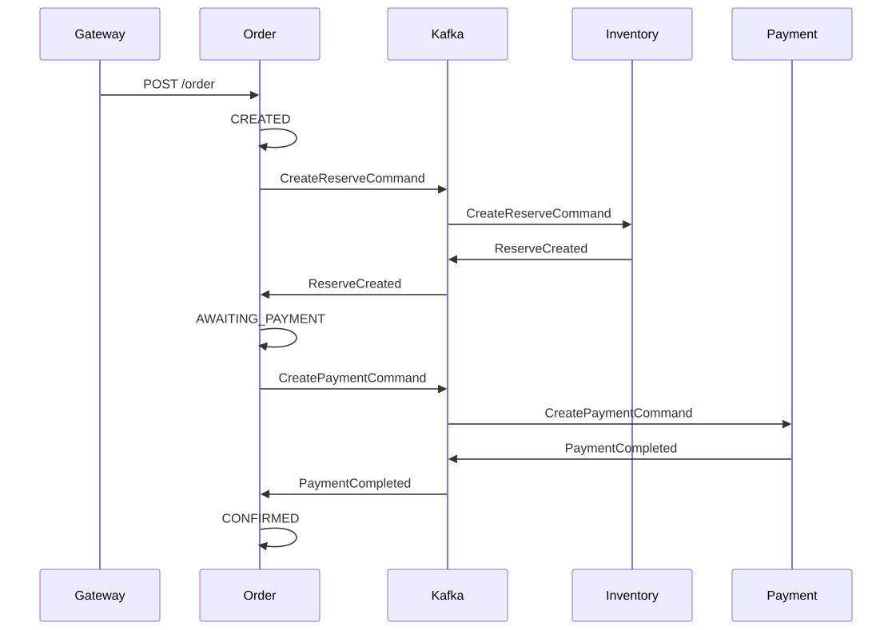

# saga-orders

Интернет-магазин из трёх сервисов: заказы, склад и оплата. У каждого сервиса своя база PostgreSQL, общей транзакции нет. Шаги связывает сага: цепочка локальных транзакций, в которой отказ любого шага откатывается компенсацией. Сагой управляет сервис заказов, а сообщения между сервисами ходят через Kafka.

Что в проекте сделано:

- сага с координатором и двумя ветками компенсации;
- transactional outbox: изменение данных и исходящее сообщение пишутся одной транзакцией;
- идемпотентные обработчики: повторная команда не спишет ни товар, ни деньги второй раз;
- блокировка остатка `SELECT … FOR UPDATE` и строгий автомат статусов заказа;
- тесты на Testcontainers, причём сквозные запускают три сервиса отдельными процессами;
- замер потолка под нагрузкой и разбор узкого места.

**Стек:** Java 21, Spring Boot 4.1.1, Spring Cloud Gateway, Kafka, PostgreSQL, Liquibase, MapStruct, Maven, Docker Compose, Testcontainers, k6.

## Как устроено

Статусы заказа:

1. `CREATED`: заказ сохранён, запрошен резерв.
2. `AWAITING_PAYMENT`: товар зарезервирован, запрошена оплата.
3. `CONFIRMED`: оплата прошла.
4. `CANCELLED`: товара не хватило или оплата не прошла; во втором случае резерв снят.

Статусы `CONFIRMED` и `CANCELLED` конечные, из них переходов нет ([схема переходов](docs/message-flow-order-saga.html#status-machine)).



- Если резерв не удался, `ReserveFailed` сразу переводит заказ в `CANCELLED`, и оплата не запускается.
- Если не прошла оплата, цепочка `PaymentFailed` → `RevertReserveCommand` → `ReserveReverted` снимает резерв и переводит заказ в `CANCELLED`.

Подробные схемы: [поток саги](docs/message-flow-order-saga.html), [слои и модули](docs/infrastructure-layers-modules-and-runtime.html).

## Решения

**Сага вместо 2PC.** 2PC держит блокировки во всех базах до конца транзакции, а если координатор упадёт, участники будут держать их до его восстановления. Сага обходится без общих блокировок, но согласованность у неё итоговая (eventual consistency): между шагами заказ уже есть, а оплаты ещё нет.

**Оркестрация вместо хореографии.** Весь поток виден в одном месте, и компенсации проще отлаживать. Обратная сторона: любой новый сценарий затрагивает сервис заказов.

**Координатор внутри сервиса заказов.** Процессов меньше, а статус саги хранится прямо в `orders.status`. Зато сервис совмещает две роли, и координатор нельзя масштабировать отдельно.

**Outbox вместо отправки в Kafka из обработчика.** База и Kafka не умеют сохранять изменения одной транзакцией: если процесс упадёт между записью в базу и отправкой, одно случится без другого. Поэтому сообщение пишется в таблицу `outbox` той же транзакцией, что и данные, а в Kafka его отправляет отдельный поток.

**Опрос `outbox` вместо Debezium.** Не нужны ни Kafka Connect, ни чтение журнала WAL. Платим за это запросом к базе каждые 10 мс, но пустой проход стоит одного SELECT по индексу и ничего не пишет.

**`FOR UPDATE` вместо `@Version` на остатке.** Под нагрузкой в логах базы было много конфликтов версии и повторных попыток, поэтому перешли на пессимистичную блокировку. Строки блокируются в порядке возрастания id, чтобы не возникло взаимной блокировки (deadlock).

## Гарантии

- Данные и запись в `outbox` сохраняются одной транзакцией.
- Сообщение доставляется хотя бы один раз (at-least-once): если процесс упадёт между отправкой в Kafka и отметкой `PROCESSED`, сообщение уйдёт повторно.
- Повтор команды безопасен: оплата ищет платёж по `order_id`, склад ищет резерв по `order_id`, а уникальные ключи страхуют от гонки.

## Известные ограничения

| Ограничение | Решение |
|-------------|---------|
| Откат резерва удаляет его строки, поэтому повтор команды резерва после отката зарезервирует товар снова | Хранить статус резерва (`RESERVED` / `REVERTED` / `FAILED`), а на `ReserveCreated` для отменённого заказа слать откат |
| В слушателях нет своего обработчика ошибок: после повторов сообщение пропускается, и заказ застревает в промежуточном статусе, например в `AWAITING_PAYMENT` с зарезервированным товаром | Добавить обработчик ошибок с DLT и искать заказы, которые слишком долго стоят в одном статусе |
| `POST /order` не проверяется, цену присылает клиент | Проверять запрос через Bean Validation, а цену считать на складе |
| Строка `outbox`, которую не удаётся отправить, останавливает всю очередь сервиса; отправленные строки не удаляются | Переводить такие строки в отдельный статус и чистить отправленные |
| Опрос `outbox` идёт без `SKIP LOCKED`, поэтому две копии сервиса отправят одно сообщение дважды | Выбирать строки через `FOR UPDATE SKIP LOCKED` |
| `SagaFlowIT` иногда падает по таймауту: сервис заказов подписывается на топик раньше, чем склад создаст его с тремя партициями | Создавать топики до запуска сервисов |

CQRS и Circuit Breaker в основной объём не входят.

## Нагрузка

Весь стек работал в Docker на одной машине: i5-12400F, 16 ГБ, Windows 10. Заказы подавал k6 (инструмент нагрузочного тестирования от Grafana) с постоянной частотой, не дожидаясь ответов. Время саги считали от создания заказа до его конечного статуса по меткам времени в базе заказов.

| Режим | Заказов в секунду | Сага, p50 / p95 |
|-------|-------------------|-----------------|
| Обычный: коммит ждёт сброса журнала на диск | 110 | 0,10 / 0,18 с |
| Без ожидания диска (`synchronous_commit=off`) | 300 | 0,05 / 0,07 с |
| 20 % заказов с отказом оплаты | 90 | 0,16 / 0,29 с |
| Все заказы на один товар | 90 | 0,15 / 0,34 с |

Первые две строки показывают потолок: при большей частоте заказы начинают копиться в очереди. Две нижние проверяют, что компенсации и блокировка остатка не ломают сагу под нагрузкой; их отдельный предел не искали.

**В обычном режиме предел задаёт диск, а не код.** Под нагрузкой SSD раз в несколько минут замедляет запись с 0,8 мс до 60–590 мс, и коммиты всех трёх баз встают одновременно на 30–60 с. Такое случалось при любой частоте от 30 заказов в секунду. Это видно по счётчикам диска, по ожиданию `COMMIT` в Postgres и по дампам потоков. Режим без ожидания диска включали только для того, чтобы отделить код от диска: в работе так нельзя, потому что при сбое Postgres пропадут уже подтверждённые строки `outbox`.

**Что ускорили после прошлого замера.** Раньше данные Postgres лежали в папке проекта на HDD, и каждый коммит ждал сброса журнала 16,6 мс. Данные перенесли на тома Docker, которые лежат на SSD, и сброс стал занимать 2,9 мс. Сколько из этой разницы дал сам диск, а сколько прослойка WSL2 между контейнером и папкой Windows, отдельно не мерили. Вместе с опросом `outbox` раз в 10 мс вместо 50 и `linger.ms=2` у продюсера это сократило сагу одного заказа с 415 до 82 мс по меткам в базе.

Методика, полные таблицы и разбор лежат в [docs/load/](docs/load/); начать лучше с [поиска потолка](docs/load/2026-11-04-ceiling.md).

## Тесты

Тесты поднимают PostgreSQL и Kafka через Testcontainers.

| Что проверяем | Тест |
|---------------|------|
| Заказ доходит до `CONFIRMED` | `SagaFlowIT` |
| Отказ резерва; отказ оплаты с возвратом остатка | `SagaFlowIT` |
| Отказ резерва и оплаты внутри сервиса | `InventoryCompensationTest`, `PaymentFailureTest` |
| Повтор резерва и оплаты не списывает второй раз | `InventoryReserveTest`, `PaymentIdempotencyTest` |
| Два резерва последней единицы товара | `InventoryReserveTest` |
| Запрещённый переход статуса | `OrderSagaStatusTest` |

`SagaFlowIT` запускает три сервиса отдельными процессами `java -jar`, потому что в одном процессе они увидели бы бины друг друга.

`.\mvnw.cmd test` запускает тесты одного сервиса, `.\mvnw.cmd verify` добавляет к ним сквозные.

## Запуск

Нужны Docker и JDK 21. Скрипты в `scripts/` написаны на PowerShell и рассчитаны на Windows. Команды выполняются из корня репозитория.

Чтобы запустить инфраструктуру в Docker, а приложения в IDE:

```powershell
docker compose up -d
```

Затем запустите Gateway, Order, Inventory и Payment. Базу каждого сервиса Spring Boot поднимет сам через свою поддержку Docker Compose.

Чтобы запустить весь стек в контейнерах, один раз выполните `.\scripts\docker-up.ps1` (первая сборка идёт долго), а дальше `.\scripts\to-docker.ps1`. Перед этим остановите приложения в IDE: порты 8081–8084 должны быть свободны. Вернуться к режиму IDE поможет `.\scripts\to-idea.ps1`.

| Что | Порт |
|-----|------|
| Gateway | 8081 |
| Inventory / Order / Payment | 8082 / 8083 / 8084 |
| Kafka / Kafka UI | 9092 / 8090 |
| pgAdmin | 5050 (`admin@example.com` / `admin`) |
| Демо-интерфейс | 5173 |
| Postgres order / payment / inventory | 5433 / 5434 / 5435 |

## Демо

На http://localhost:5173 есть три кнопки: успешный заказ, нехватка товара и отказ оплаты. Статус заказа на странице обновляется, пока не станет конечным.
