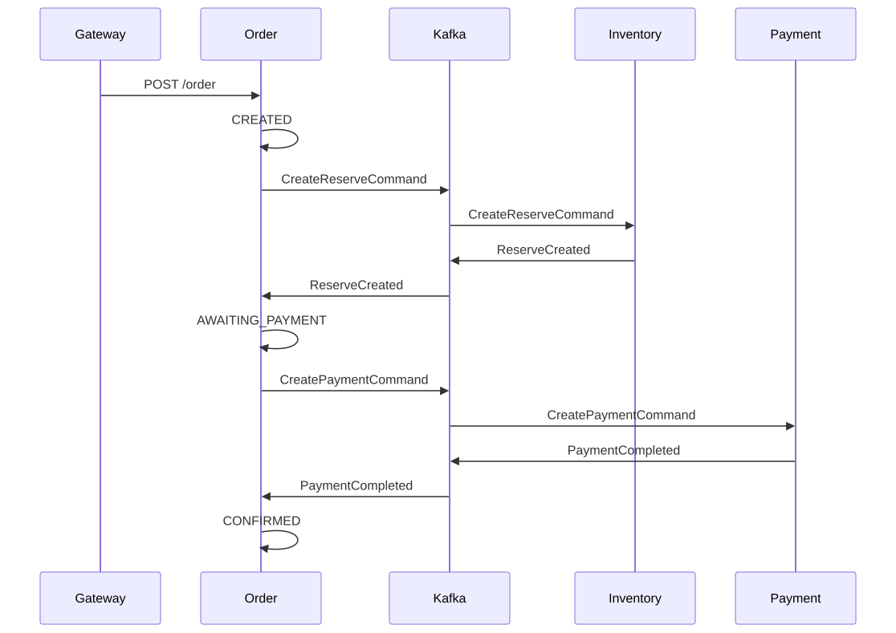

# saga-orders

Пет-проект интернет-магазина: заказ, склад и оплата — три сервиса, у каждого своя PostgreSQL. Общей транзакции на «создать заказ, зарезервировать товар и списать деньги» нет. Шаги связывает **сага (Saga)**: цепочка локальных операций. Если шаг не удался, предыдущие откатываются (например, снимается резерв).

Координатор — сервис заказов: по статусу заказа решает, какую команду слать дальше.

## Стек

Java 21, Spring Boot 4.1.1, Spring Cloud Gateway, Apache Kafka, PostgreSQL, Liquibase, Maven (несколько модулей), MapStruct, Docker Compose, Testcontainers. Фронт — Vite.

## Архитектура

Сага с оркестрацией: один координатор в сервисе заказов.

Статусы заказа:

1. `CREATED` — заказ сохранён, запрошен резерв на складе
2. `AWAITING_PAYMENT` — товар зарезервирован, запрошена оплата
3. `CONFIRMED` — оплата прошла
4. `CANCELLED` — не хватило товара (оплату не запускали) или оплата не прошла (резерв сняли)

Прочие особенности: своя база на сервис; исходящие сообщения — через таблицу `outbox` в той же транзакции, что изменение данных; оптимистичная блокировка остатка на складе (`@Version`).



Отказ резерва: `ReserveFailed` → `CANCELLED`, оплату не запускаем. Отказ оплаты: `PaymentFailed` → `RevertReserveCommand` → `ReserveReverted` → `CANCELLED`.

Те же схемы в HTML: [поток саги](docs/message-flow-order-saga.html), [слои и модули](docs/infrastructure-layers-modules-and-runtime.html).

## Решения и компромиссы

**Сага, а не распределённая транзакция (two-phase commit).** Три отдельные базы нельзя обернуть в одну ACID-транзакцию без 2PC. 2PC держит блокировки на время всех участников и плохо переживает падение координатора. Сага меняет это на последовательность локальных транзакций и компенсацию. Цена — согласованность не мгновенная: между шагами заказ уже есть, а оплаты ещё нет.

**Оркестрация, а не хореография.** Поток читается в одном месте (сервис заказов), проще отлаживать компенсации. Цена — заказ становится узлом, от которого зависят склад и оплата; смена сценария почти всегда трогает этот сервис.

**Координатор внутри сервиса заказов, а не отдельный процесс.** Меньше движущихся частей, статус саги = `orders.status`. Цена — у сервиса две роли (домен заказов и координация), его нельзя масштабировать отдельно от оркестратора, доменная модель обрастает переходами саги.

**Поллер `outbox`, а не Debezium.** Не нужен Kafka Connect и разбор WAL. Для учебной нагрузки задержки около секунды достаточно. Цена — лишние запросы к своей базе и нет CDC «из коробки».

## Гарантии и ограничения

Запись в `outbox` и изменение заказа / резерва / платежа — одна транзакция: «сохранили в базе, но не собирались слать» не бывает.

Дальше поллер шлёт в Kafka и только потом ставит `PROCESSED`. Если процесс умрёт между этими шагами, строка останется `NEW` и уйдёт снова. Это доставка **как минимум один раз**, не ровно один.

Поэтому потребители не должны выполнять побочный эффект дважды:

- оплата — одна запись на `order_id`; повтор команды возвращает тот же исход;
- склад — уникальность резерва `(order_id, item_id)`; повторный разбор команды как у оплаты не сделан: повтор может снова уменьшить остаток, пока не упрётся в unique.

Поллер читает пачку `NEW` без `FOR UPDATE SKIP LOCKED`. Два экземпляра сервиса могут взять одну строку; для одного локального процесса это не проблема.

Не делается (и не планируется в этом объёме): таймауты саги, отдельная read-модель (CQRS), Circuit Breaker.

## Запуск

Нужны Docker и JDK 21. Maven Wrapper уже в репозитории.

Разработка (инфра в Docker, приложения в IDE; рабочий каталог запуска — **корень репо**):

```powershell
docker compose up -d
```

Затем Gateway, Order, Inventory, Payment. Postgres каждого сервиса поднимется сам (`profile db`).

Весь стек в контейнерах (сборка образов долгая):

```powershell
.\scripts\docker-up.ps1
```

Если образы уже есть: `.\scripts\to-docker.ps1`. Сначала остановите приложения в IDE (порты 8081–8084). Обратно в IDE: `.\scripts\to-idea.ps1`.

| Что | Порт |
|-----|------|
| Gateway | 8081 |
| Inventory / Order / Payment | 8082 / 8083 / 8084 |
| Kafka | 9092 |
| Консоль Kafka | 8090 |
| pgAdmin | 5050 (`admin@example.com` / `admin`) |
| Фронт (Vite) | 5173 |
| Postgres order / payment / inventory | 5433 / 5434 / 5435 |

Фронт: http://localhost:5173. Запросы — на http://localhost:8081.

Успешный путь → `CONFIRMED`:

```http
POST http://localhost:8081/order
Content-Type: application/json

{
  "userId": 1013,
  "cost": 1149.00,
  "orderItems": [
    { "itemId": 1, "amount": 1, "cost": 999.00 },
    { "itemId": 2, "amount": 1, "cost": 150.00 }
  ]
}
```

Дальше `GET http://localhost:8081/order/{id}` — статус станет `CONFIRMED`.

Нехватка на складе → `CANCELLED` (в сидах у товара `1` остаток 50, `amount: 999`):

```http
POST http://localhost:8081/order
Content-Type: application/json

{
  "userId": 1013,
  "cost": 999.00,
  "orderItems": [
    { "itemId": 1, "amount": 999, "cost": 999.00 }
  ]
}
```

Отказ оплаты → снять резерв → `CANCELLED` (`userId` **9999**):

```http
POST http://localhost:8081/order
Content-Type: application/json

{
  "userId": 9999,
  "cost": 1149.00,
  "orderItems": [
    { "itemId": 1, "amount": 1, "cost": 999.00 },
    { "itemId": 2, "amount": 1, "cost": 150.00 }
  ]
}
```

## Работа с AI

Агент помогает планировать и объяснять подход. Код саги пишется вручную.

- Правила Cursor: [.cursor/rules](.cursor/rules)
- Контекст репозитория для агента: [AGENTS.md](AGENTS.md)
